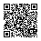

# Xin chào, mình là **nguyentamdat**

### Developer thích xây sản phẩm gọn, đẹp và giải quyết vấn đề thật

---

## Về mình

- Đang tập trung vào **web/app development**, UI sạch và trải nghiệm người dùng tốt.
- Thích biến ý tưởng thành sản phẩm có thể dùng được: nhanh, rõ ràng, dễ mở rộng.
- Quan tâm đến **frontend**, **backend**, **automation** và các công cụ AI hỗ trợ công việc.
- Luôn học thêm công nghệ mới và cải thiện chất lượng code qua từng dự án.

---

## Tech stack

---

## Dự án nổi bật

### VietQR

Tạo và kiểm tra mã VietQR ngay trong trình duyệt bằng Rust + WebAssembly, không gửi dữ liệu tài khoản lên máy chủ. Mã nguồn: [nguyentamdat/vietqr](https://github.com/nguyentamdat/vietqr) · crates: [vietqr-core](https://crates.io/crates/vietqr-core), [vietqr-render](https://crates.io/crates/vietqr-render), [vietqr-wasm](https://crates.io/crates/vietqr-wasm).

[**Dùng thử VietQR →**](https://nguyentamdat.github.io/nguyentamdat/vietqr/)

*QR mẫu dùng tài khoản giả `0000000000`, ngân hàng `970436`, số tiền `50.000 VND`, nội dung `Demo VietQR`. Chỉ để minh họa, không chuyển tiền; luôn kiểm tra bằng ứng dụng ngân hàng.*

| Dự án | Mô tả | Công nghệ |
|---|---|---|
| **Project 01** | Website giới thiệu sản phẩm với giao diện responsive, tối ưu trải nghiệm người dùng. | HTML, CSS, JavaScript |
| **Project 02** | Ứng dụng quản lý công việc giúp theo dõi tiến độ và ưu tiên hằng ngày. | React, TypeScript |
| **Project 03** | API backend cho hệ thống CRUD, xác thực người dùng và quản lý dữ liệu. | Node.js, Express, Database |
| **Project 04** | Dashboard hiển thị số liệu, biểu đồ và trạng thái hoạt động theo thời gian thực. | React, Chart.js |

> Gợi ý: đổi tên `Project 01`, mô tả và công nghệ thành các dự án thật của bạn, rồi gắn link repo/demo vào tên dự án.

---

## GitHub stats

---

## Liên hệ

- Email: **nguyentamdat@gmail.com**
- LinkedIn: **https://linkedin.com/in/nguyentamdat**
- Portfolio: **https://bongsenlen.io.vn**

### Cảm ơn bạn đã ghé thăm profile của mình!

